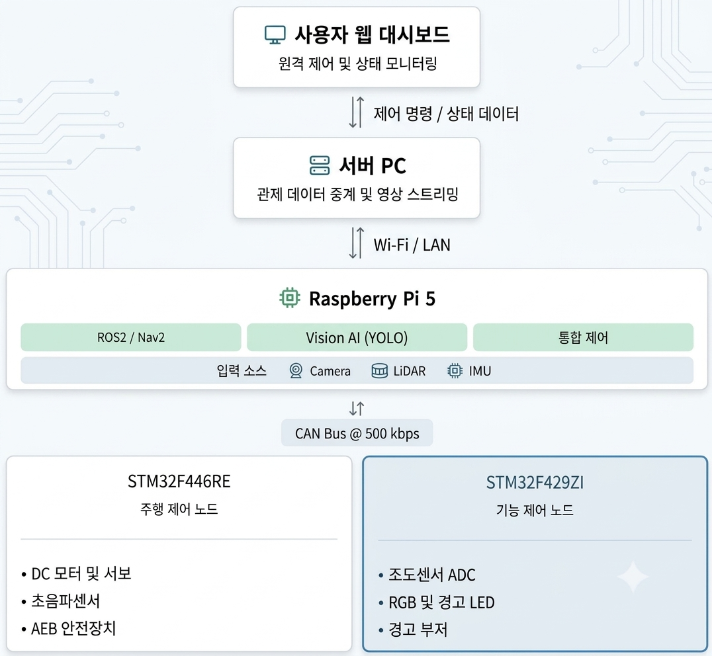
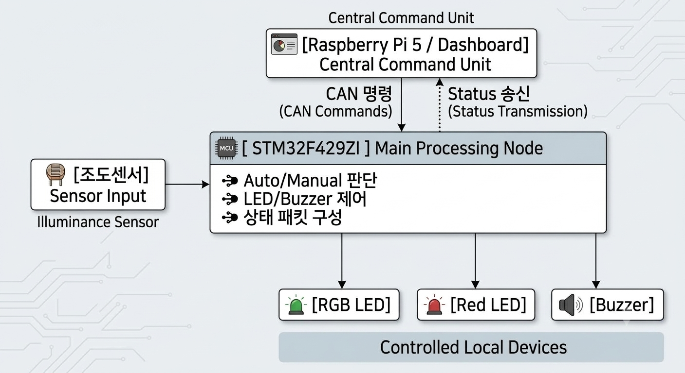
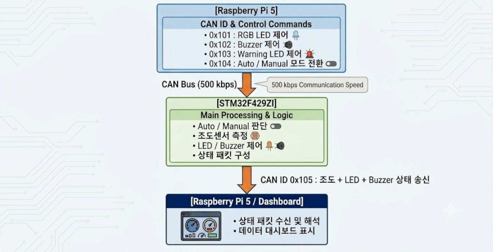
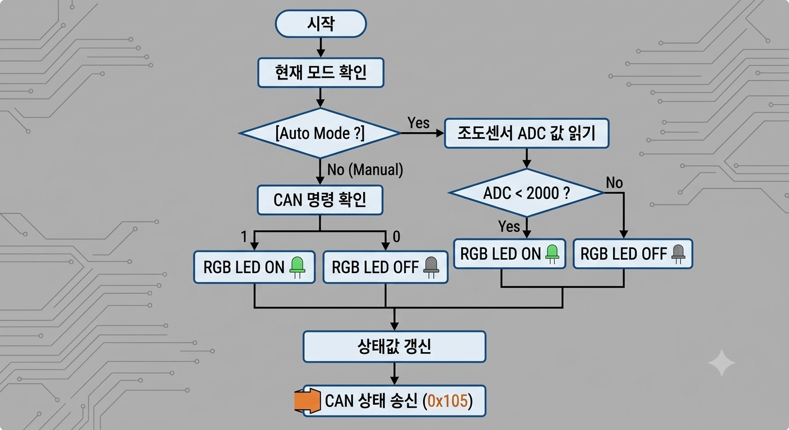

# 🤖 산업 현장 안전 순찰로봇

 - **개발기간 :** 2026.02.25 ~ 2026.03.10
 - **개발인원 :** 5명
 - **담당 역할 :** 팀장 / STM32F429ZI 기능 제어 노드 펌웨어 개발 / HW 통합·검증

---
## 📌 프로젝트 개요

산업 현장의 작업자 안전 확보와 위험 상황 모니터링을 목적으로 한 **자율주행 순찰·안전장비 미착용 감지·CAN 기반 분산 제어·웹 원격 관제 기능을 통합한 이동형 순찰로봇 시스템**

<!-- [이미지 1 | 프로젝트 개요 아래] 전체 시스템 구조도
     웹 브라우저 ↔ Node.js 서버 ↔ Raspberry Pi 5 ↔ CAN Bus ↔ STM32F446RE / STM32F429ZI
     F429 담당 영역을 색상으로 강조하세요.
     저장 경로: assets/system_architecture.png
     이미지 업로드 후 바로 아래  태그를 주석 밖으로 옮기세요. -->

  

### 프로젝트 핵심 기능

- **자율주행 순찰:** LiDAR 기반 Cartographer SLAM 및 Nav2를 활용한 자율주행
- **안전장비 감지:** YOLOv5 기반 안전모·안전조끼 착용 여부 인식 및 위험 상황 경고
- **분산 제어:** Raspberry Pi 5와 STM32F429ZI/F446RE 간 CAN 통신을 통한 센서·액추에이터·모터 제어
- **원격 관제:** 웹 대시보드를 통한 영상·센서 상태 모니터링 및 원격 제어

### 담당 역할

- **프로젝트 운영:** 팀장으로서 개발 진행 및 HW 통합 과정의 협업 조율
- **MCU 펌웨어 개발:** STM32F429ZI 기반 조도센서·RGB LED·경고 LED·부저 제어 로직 구현
- **CAN 통신 구현:** 인터럽트 기반 명령 수신, CAN ID별 기능 분기 및 센서·액추에이터 상태 송신
- **HW 통합·검증:** 센서·액추에이터 배선, 전원 구성 및 실제 로봇 동작 검증

<!-- [이미지 2 | 담당 역할 아래] STM32F429ZI 담당 시스템 구성도
     입력: 조도센서(ADC) / Raspberry Pi의 CAN 명령
     처리: Auto/Manual 모드 판단, LED·부저 제어, 상태 패킷 구성
     출력: RGB LED(PWM), 경고 LED(GPIO), 부저(PWM), CAN 상태 송신(0x105)
     저장 경로: assets/f429_function_block.png -->

  

---
## 🛠️ 사용 기술 및 개발 환경 (Tech Stack)
### 전체 시스템
- **Robot/AI:**  ROS2, Cartographer, Nav2, YOLOv5, OpenCV
- **Communication:**  CAN, UDP, RTSP, WebSocket
- **Hardware:**  Raspberry Pi 5, STM32F429ZI/F446RE, 2D LiDAR, IMU, Camera, Rover5

### 담당 개발
- **MCU/Language:** STM32F429ZI, C, STM32CubeHAL
- **Communication:** CAN Bus (500 kbps)
- **Peripheral:** ADC, Timer PWM, GPIO
- **Hardware:** RGB LED, Red LED, Buzzer, Photoresistor

---

## ⚙️ 핵심 구현

### 1. CAN 인터럽트 기반 기능 제어 노드 통신 구현

- **비동기 인터럽트 수신:** `HAL_CAN_RxFifo0MsgPendingCallback()`을 활용한 CAN RX FIFO0 메시지 수신 인터럽트를 활성화하여, 메인 폴링 루프에 의존하지 않는 비동기 이벤트 기반 수신 구조.
- **통신·제어 로직 모듈화:** CAN 메시지를 추출하는 `can_comm_rx_handler()`와 수신 ID에 따라 기능을 실행하는 `app_can_rx_cb()`를 분리하여 통신 처리와 응용 제어 로직 구분
- **CAN ID 기반 명령 처리:** 메시지 ID `0x101~0x104`에 따라 RGB LED·부저·경고 LED 및 Auto/Manual 모드 제어
- **주기적 상태 송신:** 조도센서 ADC 값(12비트) 및 액추에이터 상태를 5바이트 CAN 데이터 프레임으로 구성하여 ID `0x105`로 Raspberry Pi에 약 200ms 주기 송신

<!-- [이미지 3 | 핵심 구현 1 아래] CAN 명령·상태 보고 흐름도
     Raspberry Pi --(0x101~0x104)-- CAN Bus 500 kbps -- STM32F429ZI
     STM32F429ZI --(0x105 상태 프레임)-- CAN Bus -- Raspberry Pi
     화살표는 양방향 데이터 흐름이 분명하도록 구성하세요.
     저장 경로: assets/can_message_flow.png -->

  

**CAN 메시지 정의 (F429 담당)**

| 방향 | CAN ID | 데이터 |
| :---: | :---: | :--- |
| RX | `0x101` | RGB LED ON/OFF |
| RX | `0x102` | 부저 ON/OFF |
| RX | `0x103` | 경고 LED ON/OFF |
| RX | `0x104` | Auto/Manual 모드 전환 |
| TX | `0x105` | 조도센서 값 및 LED·부저 상태 |

**상태 보고 프레임 (`0x105`, DLC = 5)**

| Byte 0 | Byte 1 | Byte 2 | Byte 3 | Byte 4 |
| :---: | :---: | :---: | :---: | :---: |
| 조도 상위 8비트 | 조도 하위 8비트 | RGB LED 상태 | 경고 LED 상태 | 부저 상태 |

### 2. ADC·PWM 기반 자동/수동 조명 제어

- **조도센서 데이터 수집:** `ADC1_IN3` 채널의 12비트 ADC로 조도센서 아날로그 값(0~4095)을 주기적으로 수집
- **Auto 모드:** ADC 값이 임계치(`dark_th = 2000`) 미만이면 RGB LED 백색 조명을 자동 점등하고, 그 외에는 소등
- **Manual 모드:** 조도센서 측정값과 무관하게 상위 제어기의 CAN 명령에 따라 RGB LED ON/OFF 제어
- **PWM 출력 제어:** TIM1 CH1~CH3을 이용해 RGB LED 출력을 제어하고, 듀티 설정값을 최대 999로 제한하여 타이머 설정 범위 초과 방지

<!-- [이미지 4 | 핵심 구현 2 아래] Auto/Manual 조명 제어 흐름도
     현재 모드 분기 → Auto: ADC < 2000 판단 / Manual: CAN 명령 판단
     → RGB LED ON/OFF → 상태 갱신 (상태 보고는 메인 루프에서 수행)
     저장 경로: assets/auto_manual_flow.png -->

  

### 3. Vision AI 연동 시청각 경고장치 제어

- **AI 판정 결과 연동:** 상위 제어기에서 전달한 CAN 경고 명령에 따라 경고장치 제어 (AI 추론 자체는 상위 시스템의 담당 기능)
- **시각 경고:** GPIO 출력으로 적색 경고 LED ON/OFF 제어
- **청각 경고:** TIM3 CH1 PWM 기반 부저 경고음 출력 및 정지 제어
- **상태 피드백:** 경고 LED·부저의 동작 상태를 `0x105` 상태 프레임에 포함하여 상위 제어기로 전송

<!-- [선택 이미지 | 핵심 구현 3 아래] 실제 경고 LED 및 부저 동작 사진 또는 시연 캡처
     저장 경로: assets/warning_device_demo.png

  

-->

## 💡 주요 문제 해결 및 고찰 (Troubleshooting)

### 서보모터 전원 공급 문제로 인한 동작 불안정 개선

- **문제:** 실제 HW 연결 환경에서 PWM 제어 신호를 출력했음에도 서보모터가 정상적으로 구동되지 않는 현상 발생
- **원인 분석:** PWM 설정과 배선 상태를 확인하고, 서보모터 구동에 필요한 전류를 기존 전원 구성에서 충분히 공급하지 못했을 가능성 검토
- **해결:** 서보모터 구동 전원을 별도로 공급하고, 제어 보드와 외부 전원의 GND를 공통으로 연결하여 PWM 신호 기준 전위를 일치시킴
- **결과:** 전원 구성 변경 후 서보모터 정상 동작 확인. 펌웨어와 함께 전원·배선 조건을 검증하는 HW 통합 경험 확보

> 해당 사례는 F429에 탑재된 최종 기능이 아닌, 로봇 HW 통합·검증 과정에서 수행한 문제 해결 경험입니다.

<!-- [이미지 5 | 트러블슈팅 아래] 서보모터 전원 구성 Before / After 배선도
     Before: 초기 구성과 관찰된 문제 표시
     After: STM32 PWM 신호 / 서보 별도 VCC / 공통 GND를 명확히 구분
     실제 배선과 일치하게 그리세요. 측정하지 않은 '전압 강하' 등은 확정적으로 표기하지 마세요.
     저장 경로: assets/servo_power_before_after.png

  

-->

## 🔧 한계점 및 향후 개선 방향

### 1. 비차단(Non-blocking) 제어 구조 개선

- **한계:** `HAL_Delay(200)` 기반의 메인 루프에서는 ADC 측정과 CAN 상태 송신의 주기를 독립적으로 관리하기 어려움 (CAN 수신 인터럽트는 대기 중에도 처리 가능)
- **개선:** `HAL_GetTick()` 기반 비차단 주기 제어를 적용하여 센서 샘플링 및 CAN 상태 송신을 각각 독립적으로 스케줄링

### 2. 조도센서 판단 안정성 개선

- **한계:** 단일 ADC 임계값(2000)을 기준으로 조명을 전환하므로, 경계값 부근의 센서 노이즈로 반복 점등·소등이 발생할 가능성 존재
- **개선:** ADC 값 필터링 및 점등·소등 임계값 분리(Hysteresis)를 통해 판단 안정성 향상

## ✅ 주요 성과 및 배운 점

- **기능 제어 노드 구현:** 조도센서 데이터 수집 → 제어 모드 판단 → RGB LED·경고장치 구동 → CAN 상태 보고 흐름 구현
- **분산 시스템 연동:** Raspberry Pi 5와 STM32F429ZI 사이의 CAN 명령 수신 및 상태 피드백 기능 구현
- **실제 HW 검증:** 실제 로봇 조립·배선 과정에서 전원 및 제어 신호 문제를 분석하고 동작 확인
- **확장 가능성 검토:** 주기 제어와 임계값 판단 구조의 한계를 분석하고 개선 방향 도출

